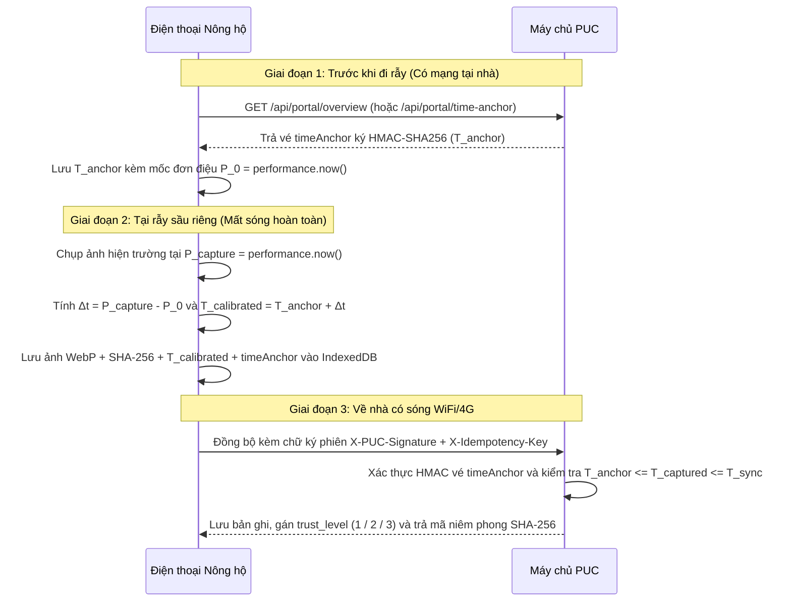

# Kiến trúc Nhật ký Canh tác Ngoại tuyến và Chống Gian lận Hiện trường (Offline-First Field Integrity)

Tài liệu này mô tả kiến trúc kỹ thuật giải quyết bài toán ghi nhận nhật ký canh tác, bón phân và phun thuốc bảo vệ thực vật tại các thửa vườn sầu riêng xa khu dân cư, nơi **không có sóng 4G hoặc WiFi**, đồng thời ngăn chặn gian lận giờ chụp, vị trí và nguồn ảnh minh chứng trên nền tảng ứng dụng web (Next.js PWA + NestJS + PostgreSQL/PostGIS).

---

## 1. Bản chất Kỹ thuật và Mô hình Mối đe dọa tại Vườn Không Sóng

### 1.1. Tách biệt giữa Định vị Vệ tinh (GNSS) và Mạng Di động (4G/WiFi)

- Chip thu vệ tinh **GNSS** (GPS, GLONASS, Galileo, BeiDou) trên điện thoại thông minh nhận tín hiệu vô tuyến trực tiếp từ vệ tinh, **không cần sóng 4G hay WiFi**.
- Khi có 4G, điện thoại tải dữ liệu lịch vệ tinh hỗ trợ (A-GPS) nên khóa vị trí trong 2 đến 5 giây. Khi hoàn toàn mất sóng dưới tán sầu riêng dày, chip GNSS khởi động lạnh (*cold start*) mất khoảng **30 đến 60 giây** để giải mã quỹ đạo trực tiếp từ vệ tinh. Do đó, nếu hàm định vị đặt thời gian chờ ngắn (ví dụ 8 giây), thiết bị sẽ báo lỗi dù phần cứng định vị vẫn hoạt động bình thường.

### 1.2. Bốn rủi ro gian lận chính khi ngoại tuyến trên trình duyệt Web

1. **Ảnh cũ từ thư viện máy**: Nông hộ chụp sẵn nhiều ảnh từ hôm trước hoặc lấy ảnh từ vườn khác trong thư viện điện thoại để nộp cho nhiều ngày.
2. **Chỉnh lùi hoặc vặn tăng đồng hồ điện thoại**: Trên trình duyệt Web, cả `Date.now()` lẫn `GeolocationPosition.timestamp` đều chịu ảnh hưởng từ đồng hồ hệ thống của thiết bị khi ngoại tuyến, người dùng có thể vào Cài đặt đổi ngày giờ trước khi chụp.
3. **Đứng sai vị trí thửa đất**: Đứng ở nhà hoặc ở thửa đã đạt chuẩn để khai khống nhật ký cho thửa khác.
4. **Sửa đổi hoặc nhân đôi dữ liệu trước và trong lúc đồng bộ**: Mạng chập chờn ngoài bìa rừng dễ gây đứt kết nối giữa chừng hoặc gửi trùng bản ghi.

---

## 2. Sơ đồ Kiến trúc Tổng thể

```mermaid
flowchart LR
  subgraph Orchard["Điện thoại Nông hộ tại Rẫy (Không có 4G/WiFi)"]
    A["Mở PWA từ bộ nhớ đệm Service Worker"] --> B["Camera trực tiếp trong trang (getUserMedia + Canvas)"]
    A --> C["Thu vệ tinh GNSS 60 giây (watchPosition) và Quét QR biển vườn"]
    B --> D["Nén tuần tự WebP tiết kiệm RAM và băm SHA-256 tại chỗ"]
    C --> E["Gắn vé neo giờ máy chủ + đồng hồ đơn điệu performance.now()"]
    D --> F["Lưu hàng đợi IndexedDB an toàn 14 ngày"]
    E --> F
  end

  subgraph Server["Máy chủ Hợp tác xã (Khi điện thoại về vùng có mạng)"]
    F -->|"Tự động đồng bộ kèm X-Idempotency-Key + X-Upload-Sha256"| G["Đối chiếu SHA-256 tệp ảnh và chống ghi trùng"]
    G --> H["Kiểm tra điểm GPS trong đa giác PostGIS + Biển QR thửa đất"]
    H --> I["Kiểm chứng kẹp thời gian máy chủ 2 đầu (Server Time-Bounding)"]
    I --> J["Chấm mức tin cậy thực địa (Mức 1 / 2 / 3) và nối chuỗi băm SHA-256"]
  end

  subgraph Dossier["Cổng Quản trị HTX và Hồ sơ Truy xuất QR Khổ A4"]
    J --> K["Cán bộ HTX rà soát bản ghi Mức 3 và xác minh thực địa"]
    J --> L["Hiển thị minh bạch trạng thái GPS, QR thửa và mã băm cho đối tác nhập khẩu"]
  end
```

---

## 3. Bảy Lớp Bằng chứng Xác thực Đa tầng

| Lớp bảo vệ | Cơ chế thực thi trên thiết bị và máy chủ | Gian lận ngăn chặn được |
|---|---|---|
| **1. Chụp ảnh trực tiếp tại vườn** | Chế độ `cameraOnly` ẩn hoàn toàn nút chọn thư viện ảnh; mở ống kính sau ngay trong trang bằng `getUserMedia` + `<canvas>`, nén tuần tự sang WebP và ghi `capture_source = 'in_app_camera'`. Với máy đời cũ phải gọi camera hệ điều hành (`capture="environment"`), kiểm tra chặt tuổi tệp dưới 3 phút. | Lấy ảnh cũ chụp từ nhiều ngày trước trong thư viện máy. |
| **2. Mã băm ảnh SHA-256 tức thì** | Ngay khoảnh khắc chụp xong tại vườn, trình duyệt tính mã băm `SHA-256` trên luồng byte ảnh (`computeBlobSha256Hex`) và gửi kèm header `X-Upload-Sha256` khi đồng bộ; máy chủ băm lại và từ chối nếu sai lệch 1 bit. | Tráo đổi tệp ảnh hoặc lỗi hỏng dữ liệu khi truyền qua sóng yếu. |
| **3. Khóa vệ tinh GNSS 60 giây** | Tự động kích hoạt `navigator.geolocation.watchPosition` (`enableHighAccuracy: true, timeout: 60000, maximumAge: 0`) ngay khi mở biểu mẫu cho cả nhật ký canh tác và phun thuốc; liên tục giữ tọa độ có sai số `gpsAccuracyM` thấp nhất và tự ngắt khi sai số đạt từ 18m trở xuống để tiết kiệm pin. | Mất tọa độ oan do chip GPS khởi động lạnh dưới tán sầu riêng khi không có 4G. |
| **4. Ranh giới đa giác PostGIS** | Máy chủ đối chiếu tọa độ thực tế với ranh giới địa chính của đúng thửa đất bằng `ST_Covers` và `ST_Distance` hệ mét thực, cộng dung sai thích ứng theo sai số vệ tinh dưới tán cây (tối đa 50m). | Đứng ở nhà hoặc thửa đất khác để ghi nhật ký khống. |
| **5. Quét bảng QR vật lý tại thửa** | Mỗi thửa vườn có mã `qr_token` bí mật không đoán lặp in trên biển gắn cố định ngoài vườn. Nông hộ quét ngay trong biểu mẫu bằng `BarcodeDetector` + `jsQR` (chạy 100% ngoại tuyến), tự chọn đúng mã thửa và gửi `signboardQrToken` để máy chủ xác thực `signboard_qr_verified = true`. | Giả mạo hiện trường hoặc mất tín hiệu GPS ở khe núi sâu nhưng vẫn cần chứng minh có mặt tại thửa. |
| **6. Kẹp thời gian máy chủ 2 đầu** | Khi còn ở nhà có mạng, máy chủ cấp vé `timeAnchor` ký `HMAC-SHA256` (`v1.<userId>.<householdId>.<issuedAtMs>.<nonce>.<sig>`). Khi lên rẫy mất sóng, máy gắn kèm độ trôi đồng hồ đơn điệu `performance.now()`. Khi đồng bộ về, máy chủ kiểm tra bất đẳng thức $T_{\text{anchor}} \le T_{\text{captured}} \le T_{\text{sync}}$. | Chỉnh lùi ngày giờ trong Cài đặt điện thoại để hợp thức hóa nhật ký cũ hoặc khai trước ngày tương lai. |
| **7. Sổ cái chuỗi băm bất biến** | Trigger PostgreSQL tự động nối mã băm `record_hash` (`JOURNAL-V1` và `SPRAY-V1`) theo thứ tự bản ghi kèm nhật ký kiểm toán bất biến `immutable_change_logs` khi cán bộ chỉnh sửa hoặc xác minh. | Chèn lén, sửa đổi hoặc xóa dấu vết nhật ký sau khi đã đồng bộ lên máy chủ. |

---

## 4. Thuật toán Kẹp Thời gian Máy chủ Hai đầu (Server Time-Bounding)

Vì trình duyệt Web ngoại tuyến không đọc được khung giờ phần cứng thô của vệ tinh GPS một cách độc lập với hệ điều hành, hệ thống kết hợp **Vé neo thời gian có chữ ký HMAC** và **Đồng hồ đơn điệu (`performance.now()`)**:

### Các trường hợp kiểm chứng thời gian tại máy chủ (`field-evidence.ts`):

1. **Cùng phiên mở ứng dụng (`monotonicElapsedMs` hợp lệ)**:
   - Thời điểm thực chụp được tính trực tiếp từ mốc máy chủ: $T_{\text{effective}} = T_{\text{anchor}} + \Delta t_{\text{monotonic}}$.
   - Nếu đồng hồ hệ thống `clientCapturedAt` lệch quá 10 phút so với $T_{\text{effective}}$, hoặc $T_{\text{effective}} > T_{\text{sync}} + 3\text{ phút}$, máy chủ gắn cờ `clock_skew`.
2. **Đã đóng trình duyệt rồi mở lại ngoài rẫy**:
   - Vé `timeAnchorToken` lưu trong bộ nhớ cục bộ của nông hộ vẫn giữ nguyên chữ ký HMAC của máy chủ cho $T_{\text{anchor}}$.
   - Máy chủ kiểm tra chặt: $T_{\text{anchor}} - 2\text{ phút} \le T_{\text{device}} \le T_{\text{sync}} + 3\text{ phút}$ và ngày thực hiện không được vượt quá ngày chụp thực tế tại vườn. Nếu nông hộ vặn lùi đồng hồ về trước thời điểm nhận vé $T_{\text{anchor}}$ hoặc vặn tới tương lai, máy chủ lập tức phát hiện `clock_skew`.

---

## 5. Phân cấp Độ tin cậy 3 Mức (`trust_level`)

Hệ thống không chặn cứng làm mất dữ liệu công sức đi rẫy của nông hộ khi gặp điều kiện địa hình bất lợi, mà phân loại minh bạch thành **3 mức độ tin cậy** để cán bộ HTX, doanh nghiệp thu mua và đoàn thanh tra đối chiếu:

| Mức | Nhãn hiển thị | Điều kiện đạt tự động hoặc xác minh | Ý nghĩa nghiệp vụ |
|---|---|---|---|
| **Mức 1** | **Xác thực thực địa cao** | Chụp trực tiếp (`in_app_camera` hoặc `camera`), **khớp đa giác GPS của thửa đất** (sai số $\le 65\text{ m}$) **hoặc khớp biển QR cắm tại thửa**, đồng bộ trong vòng 48 giờ, không lệch giờ máy; **hoặc** đã được cán bộ HTX xác minh thực địa (`staff_verified`). | Đủ độ tin cậy cao nhất cho hồ sơ xuất khẩu chính ngạch và kiểm định GACC. |
| **Mức 2** | **Đã ghi nhận hợp lệ** | Chụp trực tiếp tại hiện trường, đồng bộ trong hạn ($\le 72\text{ giờ}$), không có dấu hiệu gian lận giờ hoặc sai thửa, nhưng rẫy khuất sóng vệ tinh chưa khóa kịp tọa độ GPS và chưa quét bảng QR đầu thửa. | Ghi nhận hợp lệ trong sổ nhật ký điện tử; khuyến khích quét thêm bảng QR vườn ở các lần sau. |
| **Mức 3** | **Cần cán bộ xác minh** | Phát hiện ít nhất một dấu hiệu bất thường: tọa độ nằm ngoài ranh giới thửa (`outside_plot`), lệch đồng hồ thiết bị (`clock_skew`), mã QR biển vườn không khớp (`invalid_signboard_qr`), ảnh tải từ thư viện (`gallery_upload`), khai lùi quá 3 ngày hoặc ngâm đồng bộ quá 72 giờ (`late_sync`). | Vẫn lưu trung thực nhưng hiển thị cảnh báo màu hổ phách trên Cổng Quản trị để cán bộ kỹ thuật HTX kiểm tra và bấm xác nhận sau khi đối chiếu thực tế. |

---

## 6. Cấu trúc Cơ sở Dữ liệu và Các Tệp Mã nguồn Chính

### 6.1. Cột dữ liệu bổ sung (`backend/db/migrations/044_offline_field_evidence_trust_tiers.sql`)

Trên cả hai bảng `journal_entries` (nhật ký canh tác) và `spray_records` (nhật ký phun thuốc BVTV):

- `latitude`, `longitude`, `gps_accuracy_m`: Tọa độ vệ tinh GNSS và bán kính sai số (mét).
- `gps_verified`, `gps_distance_m`: Kết quả đối chiếu ranh giới đa giác PostGIS và khoảng cách tới ranh giới thửa (mét).
- `capture_source`: Nguồn thu nhận minh chứng (`in_app_camera`, `camera`, `upload`, `system`).
- `client_captured_at`: Thời điểm chụp thực tế đã hiệu chuẩn theo cửa sổ thời gian máy chủ.
- `offline_queued`: Đánh dấu bản ghi được ghi tại vùng mất sóng và đẩy tự động từ hàng đợi ngoại tuyến.
- `signboard_qr_verified`: Đánh dấu đã quét khớp mã `qr_token` của biển vườn vật lý tại thửa đất.
- `trust_level` (`SMALLINT`, nhận giá trị `1`, `2`, `3`) và `trust_flags` (`TEXT[]`): Mức độ tin cậy thực địa và tập cờ bằng chứng phục vụ kiểm toán.

### 6.2. Sơ đồ phân bổ trong kho mã

- **Backend (`backend/`)**:
  - `db/migrations/044_offline_field_evidence_trust_tiers.sql`: Định nghĩa schema, ràng buộc toàn vẹn và chỉ mục lọc nhanh bản ghi cần xác minh.
  - `src/portal/common/field-evidence.ts`: Cấp/kiểm tra vé `timeAnchor` HMAC-SHA256, xác thực `signboardQrToken` với bảng `plots` / `plot_signboard_tokens`, đối chiếu PostGIS và chấm điểm `trustLevel`.
  - `src/portal/overview/overview.controller.ts` và `overview.service.ts`: Endpoint `GET /api/portal/time-anchor` và đính kèm vé neo giờ mới trong `GET /api/portal/overview`.
  - `src/portal/journal/` và `src/portal/spray/`: Nhận đầy đủ trường bằng chứng thực địa từ nông hộ, lưu trữ an toàn và không ảnh hưởng chuỗi băm `JOURNAL-V1` / `SPRAY-V1`.
  - `src/resources/journal/journal.service.ts` và `src/resources/spray/spray.service.ts`: Cho phép cán bộ HTX lọc, xem chi tiết bằng chứng và thăng hạng lên Mức 1 khi bấm xác minh.
  - `src/public/traceability.service.ts`: Xuất dữ liệu `trustLevel`, `signboardQrVerified`, `gpsVerified`, `offlineQueued` và `recordHash` ra hồ sơ truy xuất QR 3 tầng quyền.
- **Frontend (`frontend/`)**:
  - `public/sw.js` và `public/manifest.webmanifest`: Bộ nhớ đệm Service Worker cho khung ứng dụng `/portal`, mảnh bản đồ và tài nguyên tĩnh.
  - `src/lib/offline-sync.ts`: Hàng đợi `IndexedDB` (`outbox`, `field_drafts`, `read_snapshots` 14 ngày chỉ dành cho vai trò `farmer`), quản lý vé `puc:time-anchor:v1`, tải tuần tự từng ảnh kèm checkpoint `SHA-256` và `X-Idempotency-Key`.
  - `src/components/portal/shared/FieldEvidenceCapture.tsx`: Khung chụp ảnh trực tiếp `FieldCameraCaptureModal`, khung quét bảng QR vườn ngoại tuyến `PlotSignboardQrScannerModal`, thẻ hướng dẫn iOS `IosPwaInstallGuideBanner` và huy hiệu `FieldTrustBadge`.
  - `src/components/portal/DiaryTab.tsx`: Biểu mẫu ghi nhật ký hợp nhất tích hợp thu vệ tinh GNSS 60 giây cho cả canh tác và phun thuốc, quét QR biển vườn và tự lưu nháp bảo vệ ảnh sau 500ms.
  - `src/app/trace/[code]/TraceView.tsx` và `FieldAuditGpsCheckCard.tsx`: Hiển thị minh chứng thực địa đa ngôn ngữ (`vi`, `en`, `zh`) trên hồ sơ truy xuất khổ giấy A4.

---

## 7. Vận hành Thực tế trên Điện thoại Android, iPhone (iOS) và Bảo mật Thiết bị Dùng chung

1. **Android (Chrome / Samsung Internet / Edge)**:
   - Hỗ trợ đầy đủ `Service Worker`, `IndexedDB`, `navigator.storage.persist()` và `Background Sync` (`puc-outbox-sync`). Khi nông hộ đi từ rẫy về tới vùng có sóng 4G/WiFi, trình duyệt tự động đẩy ảnh và nhật ký lên máy chủ.
2. **iPhone / iPad (iOS Safari)**:
   - iOS không hỗ trợ `Background Sync` chạy ngầm khi đã đóng hẳn trình duyệt và có cơ chế tự dọn bộ nhớ tạm nếu trang web lâu ngày không mở ở chế độ trình duyệt thường.
   - Giải pháp đã tích hợp sẵn:
     - Hiển thị thẻ hướng dẫn gọn trên Trang chủ Cổng nông hộ nhắc bà con bấm **Chia sẻ -> Thêm vào Màn hình chính** để chạy ở chế độ ứng dụng độc lập (*Standalone PWA*), giữ bền vững dữ liệu ngoại tuyến 14 ngày.
     - Thanh trạng thái đồng bộ nổi (`OfflineSyncBar`) hiện ngay đầu màn hình số lượng nhật ký chưa gửi kèm nút **Đồng bộ ngay** ngay khi nông hộ mở lại ứng dụng ở nơi có mạng.
3. **Cô lập bảo mật theo vai trò**:
   - Chỉ duy nhất vai trò nông hộ (`farmer`) được lưu phiên ngoại tuyến và bản chụp danh mục canh tác (`thửa đất`, `thuốc BVTV`, `phân bón`, `nhật ký`) trên máy cá nhân.
   - Các tài khoản Quản trị viên, Cán bộ HTX, Thanh tra và Doanh nghiệp tuyệt đối không lưu dữ liệu phiên nhạy cảm xuống `localStorage` hoặc `IndexedDB`. Khi đăng xuất hoặc đổi tài khoản, toàn bộ bản nháp, hàng đợi và vé thời gian của phiên trước bị xóa sạch tức thì.

